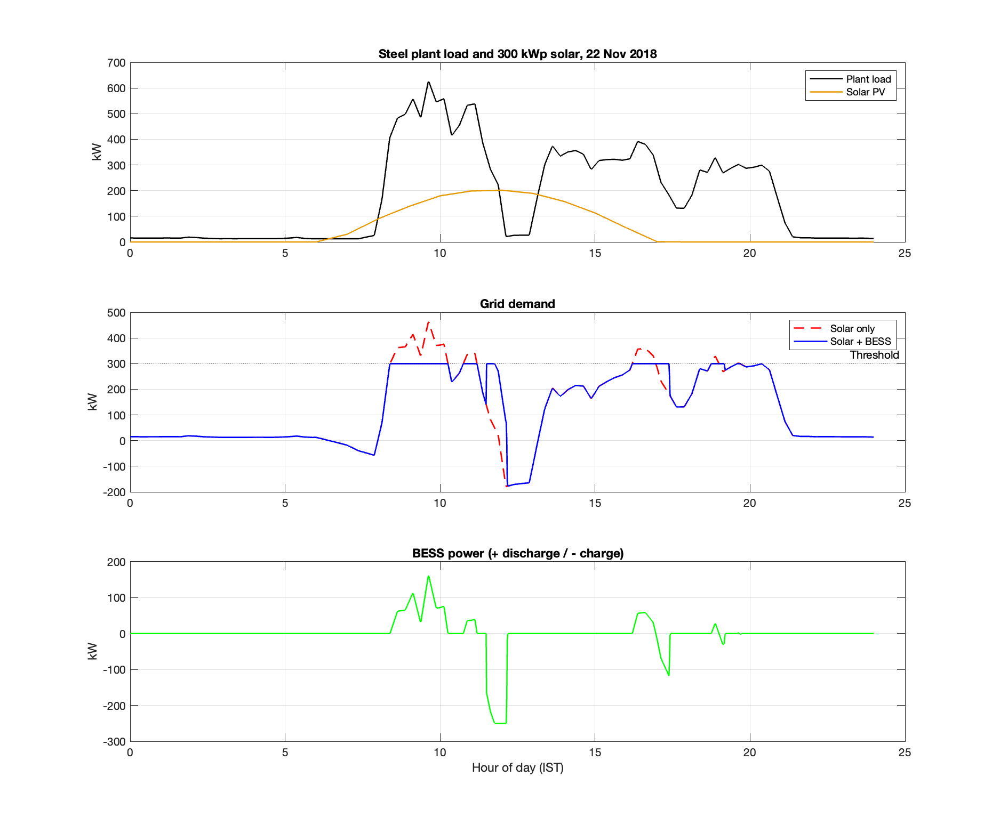
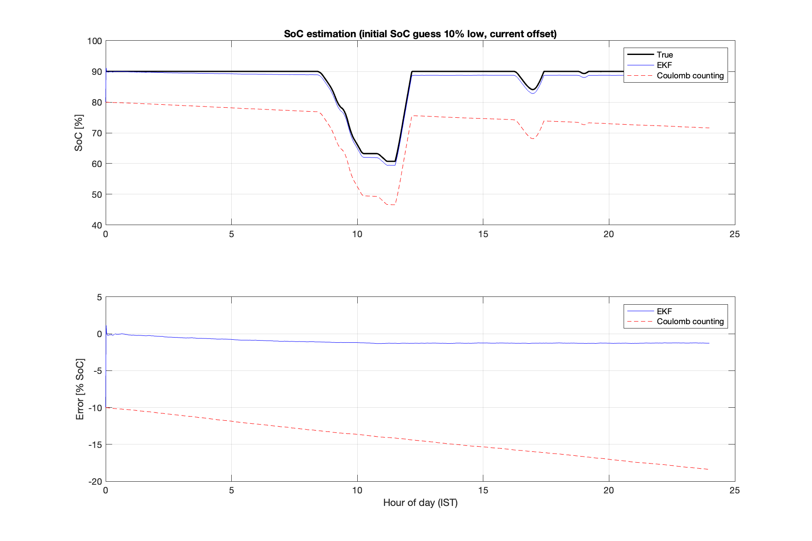
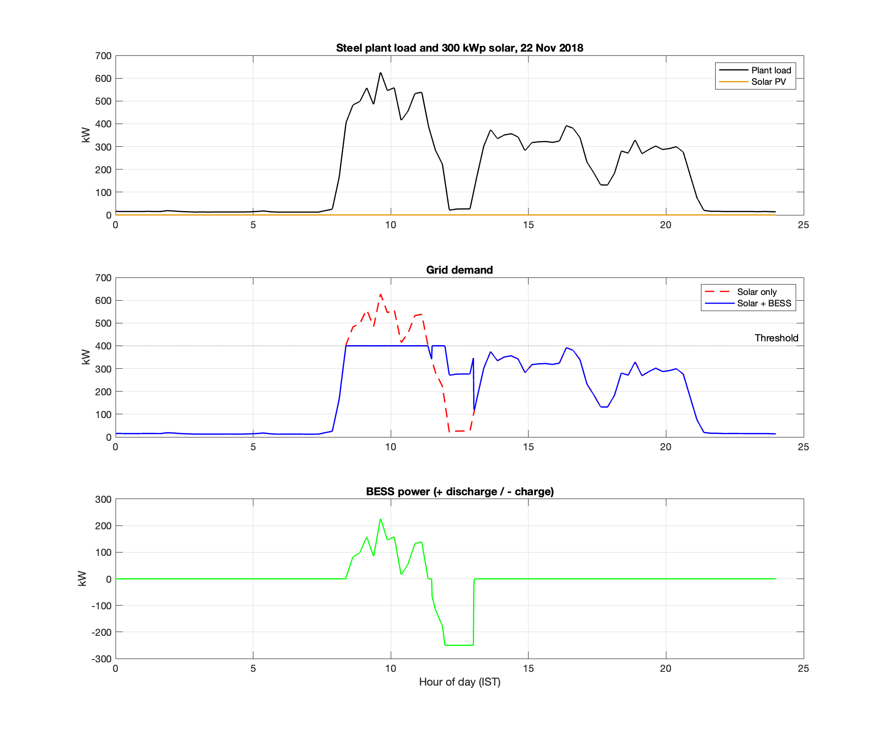
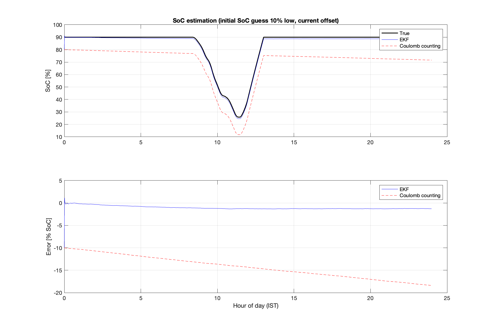

# Solar + BESS Peak Shaving for a Steel Plant (MATLAB)

Simulation of a battery energy storage system (BESS) that cuts the maximum demand of a steel plant, using **real plant load data**, **real solar data (PVGIS)** and the **Odisha (OERC) FY2026-27 tariff structure**. The battery's state of charge is estimated with an **Extended Kalman Filter (EKF)** and compared with plain coulomb counting.

## What it does

1. **Battery model:** pack-level Thevenin equivalent circuit (R0 + one RC pair) with a nonlinear OCV(SoC) curve. The EMS asks for power, the model solves for current.
2. **EMS (rule-based peak shaving):** discharge whenever grid demand would exceed a threshold; recharge after the morning peak, using solar surplus first, without creating a new peak.
3. **SoC estimation:** EKF with states [SoC, V1], against coulomb counting, under sensor noise, a 3 A current offset and a 10% wrong initial SoC.
4. **Three-case comparison:** (A) grid only, (B) solar only, (C) solar + BESS, for peak demand and daily energy cost.

## Results (22 Nov 2018, the highest-peak day of the data set)

| Scenario | Threshold | Peak demand | Estimated demand-charge saving |
|---|---|---|---|
| **No solar** (guaranteed case) | 400 kW | 626 kW -> 400 kW (-36.1 %) | Rs 56,487 / month |
| **Sunny day** (300 kWp PV) | 300 kW | 626 kW -> 461 kW (solar) -> 300 kW (-52.1 %) | Rs 81,487 / month (Rs 41,187 solar + Rs 40,300 BESS) |

- Demand charge assumed Rs 250 per kVA per month (kW treated as kVA), if the same peak recurs in the billing month.
- Energy cost: solar saves about Rs 5,993/day; the BESS adds Rs 124/day (sunny) or costs Rs 33/day in losses (no solar). **The BESS value here comes from the demand charge, not from time-of-day arbitrage**, because Odisha's ToD swing is only +/-10 %.
- Battery duty: 226 kW / 323 kWh per day (no solar), 161 kW / 189 kWh (sunny). Ohmic loss 4.0 / 1.7 kWh per day.
- **SoC estimation error (RMSE): EKF 1.1 % vs coulomb counting 14.5 %.**

| | |
|---|---|
|  |  |
|  |  |

## System assumed

| Item | Value |
|---|---|
| Battery | 500 kWh nominal (400 kWh usable, SoC 10-90 %), 250 kW converter, 170 cells in series |
| Thevenin parameters | R0 = 12 mOhm, R1 = 8 mOhm, C1 = 2000 F (generic, not fitted to a real cell) |
| Solar | 300 kWp, slope 20 deg, azimuth 0 deg, 14 % losses, 21.39 N 83.93 E |
| Tariff | Base Rs 5.80/unit (upper band for a low load-factor plant); ToD from 1 Jul 2026: -10 % 08-16 h, +10 % 18-24 h; demand charge Rs 250/kVA/month |
| Time step | 1 minute, one day |

## Data sources

- **Plant load:** Steel Industry Energy Consumption data set (Mendeley Data, DOI 10.17632/vts7r3mx79.1), 15-minute readings of a steel plant for 2018. Check the data set page for authors and licence and cite it accordingly.
- **Solar:** PVGIS (European Commission JRC), PVGIS-ERA5 hourly time series, 2018. PVGIS timestamps are UTC; the code shifts them by +5.5 h to IST.
- **Tariff:** OERC DISCOM tariff notification FY 2026-27 (orierc.org).

## How to run

1. Run `prepare_data.m` and pick the two raw CSV files when asked. It writes `steel_day.mat` and `pv_day.mat` (they are also included here).
2. Open `BESS_SteelSolar_Final.m`. Set `useSolar` (true / false) and `thr` (threshold in kW) at the top and run.

Needs MATLAB R2018b or newer (uses `yline`). No toolboxes required.

## Files

| File | Purpose |
|---|---|
| `prepare_data.m` | Builds the one-day input files from the raw data sets |
| `BESS_SteelSolar_Final.m` | Main simulation, results table and figures |
| `steel_day.mat`, `pv_day.mat` | One-day inputs (plant load, solar) |
| `fig*.png` | Result figures |

## Limitations (please read)

- **One day only.** The demand charge is billed on the monthly maximum, so the real saving depends on the worst day of the month. The "no solar" case is the safe figure; the sunny-day figure is a best case. Battery energy was sized for this day, and another day with a longer peak could need more.
- The battery parameters are generic, not identified from a real cell. No ageing, temperature effects or converter efficiency curve are modelled.
- The sensor noise is synthetic, so the EKF result shows the method works in simulation; it is not a hardware validation.
- Load data are a South Korean steel plant used as a representative industrial profile, not an Odisha plant. Its 15-minute values were interpolated to 1 minute, so real 1-minute peaks may be higher.
- Tariff: kW is treated as kVA, exported solar earns nothing, and any billing floor tied to contract demand is not modelled. Check current OERC orders before using the numbers for decisions.
- The hourly PVGIS file gave a whole-year energy of about 432 MWh, while the monthly PVGIS report for the same settings showed about 323 MWh. I did not resolve this difference, so only the daily shape of the solar profile is relied on here.
